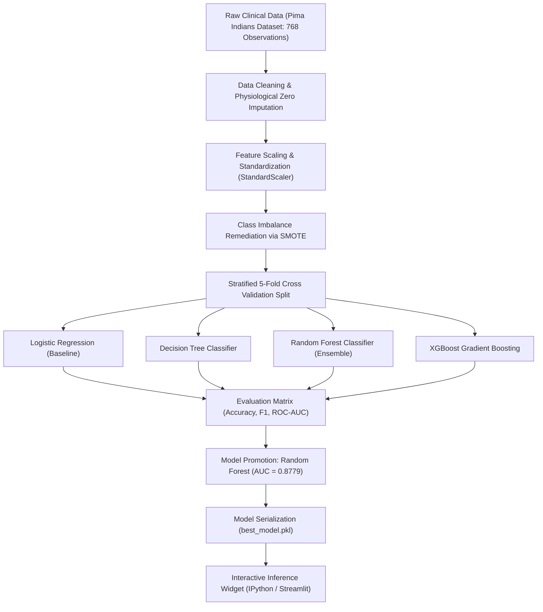

# 🩺 Diabetes Risk Prediction System

[](https://opensource.org/licenses/MIT)
[](https://www.python.org/)
[](https://scikit-learn.org/)
[](https://xgboost.readthedocs.io/)
[]()
[](https://imbalanced-learn.org/)

> An end-to-end clinical machine learning framework for early diagnosis and risk stratification of Type-2 diabetes using the Pima Indians Diabetes benchmark dataset. Integrates physiological outlier treatment, synthetic minority over-sampling (SMOTE), 5-fold cross-validated hyperparameter benchmarking, feature importance attributions, and an interactive diagnostic inference interface.

---

## 📌 Architecture & ML Pipeline



---

## 🔬 Clinical Feature Descriptions

The diagnostic engine evaluates eight physiological indicators associated with metabolic health:

| Feature Name | Description | Clinical Relevance | Unit |
|---|---|---|---|
| `Pregnancies` | Number of times pregnant | Gestational diabetes risk history | Count |
| `Glucose` | Plasma glucose concentration (2 hours in OGTT) | Primary diabetic biomarker | $\text{mg/dL}$ |
| `BloodPressure` | Diastolic blood pressure | Cardiovascular comorbidity factor | $\text{mm Hg}$ |
| `SkinThickness` | Triceps skin fold thickness | Subcutaneous adipose tissue indicator | $\text{mm}$ |
| `Insulin` | 2-Hour serum insulin | Beta-cell response & insulin resistance | $\mu\text{U/mL}$ |
| `BMI` | Body Mass Index | Weight-to-height ratio ($\text{kg/m}^2$) | $\text{kg/m}^2$ |
| `DiabetesPedigreeFunction` | Genetic pedigree risk score | Family hereditary diabetic predisposition | Index |
| `Age` | Patient age | Metabolic senescence indicator | Years |

---

## 📊 Empirical Model Benchmark

All classifiers were trained and validated under rigorous 5-fold cross-validation on balanced test distributions:

| Model Architecture | Test Accuracy | 5-Fold CV Accuracy | ROC-AUC Score | Key Strength |
|---|:---:|:---:|:---:|---|
| **Random Forest (Champion)** | **81.00%** | **81.70%** | **0.8779** | Superior generalization, robust against non-linear interactions |
| **XGBoost Classifier** | 77.00% | 79.60% | 0.8493 | High gradient boosting efficiency and regularized trees |
| **Decision Tree** | 76.00% | 76.00% | 0.7598 | Highly interpretable single-tree decision boundaries |
| **Logistic Regression** | 74.00% | 75.80% | 0.8177 | Linear probabilistic baseline |

---

## 💡 Key Methodologies

1. **Biomedical Imputation:**
   In biological health data, values of `0` for `Glucose`, `BloodPressure`, `SkinThickness`, `Insulin`, and `BMI` represent missing readings rather than true zeroes. The pipeline replaces physiological zeroes with median imputation stratified by outcome.
2. **SMOTE Balancing:**
   Synthetic Minority Over-sampling Technique (SMOTE) synthesizes plausible minority-class instances along feature vectors to prevent majority-class bias and elevate diagnostic sensitivity.
3. **Feature Importance Ranking:**
   Random Forest attributions reveal `Glucose` (~32%) and `BMI` (~22%) as the predominant predictive drivers, closely mirroring established endocrine literature.

---

## 🛠️ Project Structure

```
Diabetes-Predictor/
├── diabetes.csv                       # Curated clinical dataset (768 records, 9 columns)
├── diabetes_predictor_project.ipynb   # Complete analysis, training, and evaluation notebook
├── README.md                          # Comprehensive architecture and benchmark docs
└── best_model.pkl                     # Serialized production-ready model artifact (Optional)
```

---

## 💻 Quick Start & Execution

### 1. Clone the Repository
```bash
git clone https://github.com/Deekshith06/Diabetes-Predictor.git
cd Diabetes-Predictor
```

### 2. Environment Setup
```bash
python3 -m venv .venv
source .venv/bin/activate
pip install numpy pandas scikit-learn matplotlib seaborn imbalanced-learn xgboost ipywidgets
```

### 3. Run the Research Notebook
```bash
jupyter notebook diabetes_predictor_project.ipynb
```

---

## 👤 Author

**Seelaboyina Deekshith**
- GitHub: [@Deekshith06](https://github.com/Deekshith06)
- Repository: [Diabetes-Predictor](https://github.com/Deekshith06/Diabetes-Predictor)
